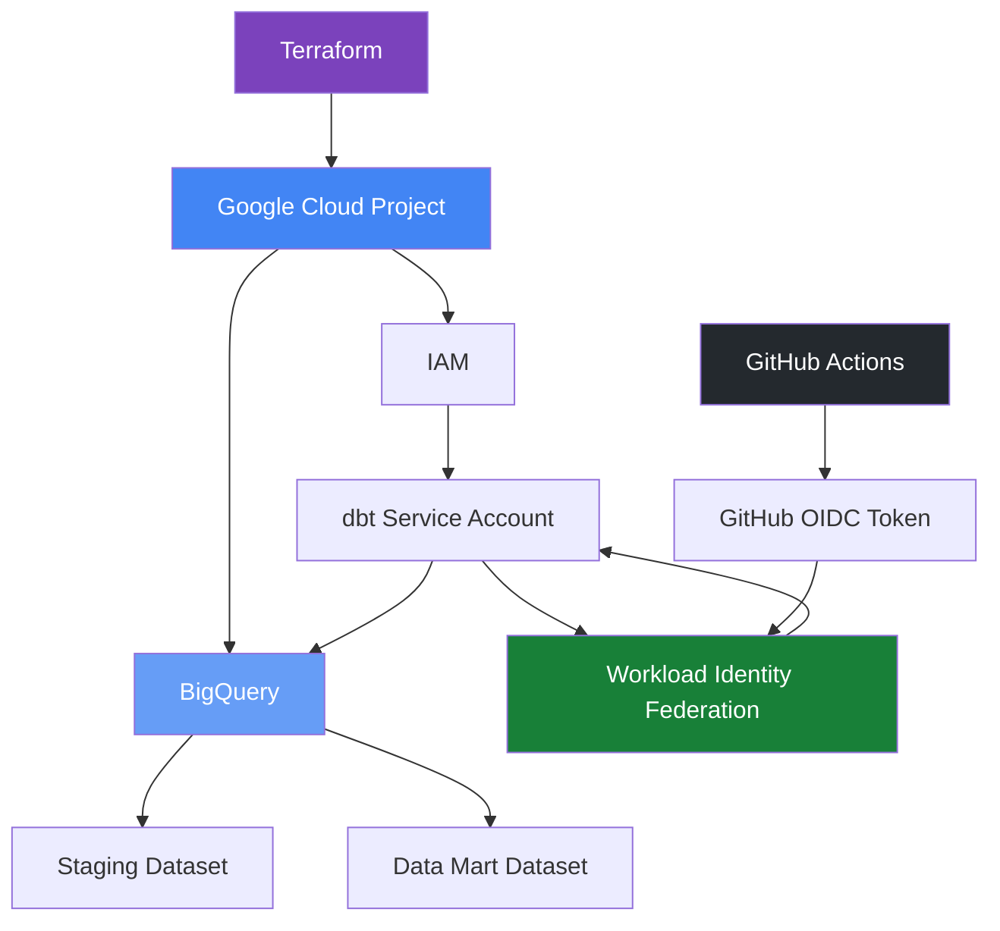

# Bitcoin Cash Astrafy

   


## 📋 Table of Contents

- [Project Overview](#project-overview)
- [Architecture](#architecture)
- [Repository Structure](#repository-structure)
- [Infrastructure Components](#️-infrastructure-components)
- [Prerequisites](#-prerequisites)
- [Deployment Instructions](#-deployment-instructions)
- [Security Considerations](#-security-considerations)
- [Infrastructure Destruction](#️-infrastructure-destruction)
- [Related Repository](#-related-repository)
- [Author](#-author)


## 🎯 Project Overview

This repository contains the Infrastructure as Code (IaC) implementation for the Bitcoin Cash Project.

The infrastructure is provisioned on Google Cloud Platform (GCP) using Terraform.

The main objective is to create and manage the cloud resources required to support a data pipeline that extracts, transforms, and analyzes Bitcoin Cash blockchain transactions.

The data architecture relies on:

Google Cloud Platform (GCP): Cloud infrastructure.
BigQuery: Data warehouse for storing and analyzing blockchain data.
dbt Core: Data transformation and modeling.
Terraform: Infrastructure provisioning and management.
GitHub Actions: Automation and CI/CD.
Workload Identity Federation: Secure authentication between GitHub Actions and GCP.

## 🏗️ Architecture

Terraform provisions and manages the following resources:

A dedicated Google Cloud project.
Required Google Cloud APIs.
Two BigQuery datasets:
staging: Stores transformed Bitcoin Cash transaction data.
data_mart: Stores analytical data, including address balances.
A dedicated service account for dbt.
IAM permissions for BigQuery operations.
A Workload Identity Pool and OIDC provider for GitHub Actions authentication.
Architecture Diagram

The following diagram illustrates the infrastructure and authentication architecture:



### Authentication Flow

GitHub Actions authenticates to Google Cloud through Workload Identity Federation (WIF).

This eliminates the need to store long-lived service account JSON keys in GitHub Secrets.

Instead, GitHub Actions generates an OpenID Connect (OIDC) token, which Google Cloud validates before allowing the workflow to impersonate the dedicated dbt service account.

## 📁 Repository Structure

The repository follows a simple Terraform project structure:

```text
bitcoin_cash/
│
├── main.tf
├── providers.tf
├── variables.tf
├── outputs.tf
├── versions.tf
├── terraform.tfvars
├── .gitignore
└── README.md
```

| File | Description |
|---|---|
| `main.tf` | Defines Google Cloud resources and IAM configuration. |
| `providers.tf` | Configures the Google Cloud Terraform provider. |
| `variables.tf` | Declares infrastructure configuration variables. |
| `outputs.tf` | Exposes important infrastructure outputs. |
| `versions.tf` | Defines Terraform and provider version requirements. |
| `terraform.tfvars` | Contains project-specific configuration values. |
| `.gitignore` | Excludes sensitive and generated Terraform files. |
| `README.md` | Documents the infrastructure and deployment process. |


## ⚙️ Infrastructure Components

### 1. Google Cloud Project

Terraform creates a dedicated Google Cloud project for the Bitcoin Cash pipeline.

The project is associated with the specified billing account and serves as the foundation for all infrastructure resources.

### 2. BigQuery Datasets

Two BigQuery datasets are provisioned to organize the analytical data.

**Staging Dataset**

| Property | Value |
|---|---|
| Dataset ID | `staging` |
| Purpose | Stores transformed Bitcoin Cash transaction data. |
| Location | US |

**Data Mart Dataset**

| Property | Value |
|---|---|
| Dataset ID | `data_mart` |
| Purpose | Stores analytical tables containing Bitcoin Cash address balances. |
| Location | US |

### 3. Service Account

Terraform provisions a dedicated Google Cloud service account:

```text
dbt-service-account
```

This service account is used by dbt to execute transformations and manage BigQuery resources.

The following IAM permissions are assigned:

| IAM Role | Scope | Purpose |
|---|---|---|
| `roles/bigquery.jobUser` | Project | Allows execution of BigQuery jobs. |
| `roles/bigquery.dataEditor` | staging dataset | Allows dbt to create and manage staging tables. |
| `roles/bigquery.dataEditor` | data_mart dataset | Allows dbt to create and manage data mart tables. |

### 4. GitHub Workload Identity Federation

GitHub Actions authenticates to Google Cloud using Workload Identity Federation (WIF).

This authentication mechanism provides several security advantages:

- Uses GitHub's OpenID Connect (OIDC) tokens.
- Eliminates the need for long-lived service account JSON keys.
- Allows secure service account impersonation.
- Restricts authentication to an authorized GitHub repository.

The Workload Identity Provider includes a repository-specific attribute condition to ensure that only the configured GitHub repository can impersonate the dbt service account.

## 📦 Prerequisites

Before deploying the infrastructure, ensure that the following requirements are met.

### Required Tools

- Google Cloud account
- Active Google Cloud billing account.
- Terraform
- Google Cloud CLI
- Google Cloud Application Default Credentials (ADC).

### Required Permissions

The authenticated Google Cloud account must have sufficient permissions to:

- Create and manage Google Cloud projects.
- Associate projects with billing accounts.
- Enable Google Cloud APIs.
- Create and manage BigQuery datasets.
- Create service accounts.
- Configure IAM permissions.
- Configure Workload Identity Pools and OIDC providers.

## 🚀 Deployment Instructions

Follow these steps to provision the infrastructure.

### Step 1. Authenticate with Google Cloud

Authenticate using the Google Cloud CLI:

```bash
gcloud auth login
```

Configure Application Default Credentials for Terraform:

```bash
gcloud auth application-default login
```

### Step 2. Initialize Terraform

Navigate to the Terraform project directory:

```bash
cd bitcoin-cash-terraform
```

Initialize the Terraform working directory:

```bash
terraform init
```

### Step 3. Configure Variables

Create a `terraform.tfvars` file in the project root directory.

Add the required configuration values:

```hcl
project_id        = "YOUR-UNIQUE-PROJECT-ID"
project_name      = "Bitcoin Cash Project"
billing_account   = "YOUR-BILLING-ACCOUNT-ID"
region            = "US"
github_repository = "YOUR-GITHUB-USERNAME/bitcoin-cash-dbt"
```

Replace the placeholder values with your actual Google Cloud and GitHub configuration.

**Note:** Do not commit sensitive configuration values or credentials to GitHub.

### Step 4. Format and Validate Terraform

Format the Terraform configuration files:

```bash
terraform fmt
```

Validate the configuration:

```bash
terraform validate
```

### Step 5. Review the Execution Plan

Generate and review the infrastructure deployment plan:

```bash
terraform plan
```

This command displays the resources Terraform intends to create, modify, or destroy.

Review the plan carefully before proceeding.

### Step 6. Deploy the Infrastructure

Apply the Terraform configuration:

```bash
terraform apply
```

Terraform will display the execution plan and request confirmation.

Enter:

```text
yes
```

Once confirmed, Terraform will provision the infrastructure on Google Cloud Platform.

### Step 7. Retrieve Infrastructure Outputs

After deployment, retrieve the configured outputs:

```bash
terraform output
```

Important outputs include:

- Google Cloud project ID.
- BigQuery dataset IDs.
- Service account email.
- Workload Identity Provider resource name.

These values can be used to configure the dbt project and GitHub Actions workflow.

## 🔐 Security Considerations

Security is an important part of the infrastructure design.

The following practices are implemented:

- **Terraform State Protection:** Terraform state files must never be committed to GitHub.
- **Credential Protection:** Service account private keys must never be committed to the repository.
- **Keyless Authentication:** GitHub Actions uses Workload Identity Federation instead of long-lived service account credentials.
- **Least Privilege:** IAM permissions are scoped to the required BigQuery datasets wherever possible.
- **Repository Restriction:** GitHub authentication is restricted through an OIDC attribute condition.
- **Configuration Protection:** Sensitive configuration values should be kept outside version control.

Always verify that `.gitignore` excludes Terraform-generated and sensitive files.

## 🗑️ Infrastructure Destruction

To remove the infrastructure when it is no longer required, execute:

```bash
terraform destroy
```

Terraform will generate a destruction plan and request confirmation.

Review the plan carefully before entering:

```text
yes
```

<details>
<summary>⚠️ Important: Data Loss Warning</summary>

Destroying the infrastructure can permanently delete Google Cloud resources, including BigQuery datasets and their contents.

Before executing this command:

- Back up any important BigQuery data.
- Verify which resources will be destroyed.
- Ensure that no other services depend on the infrastructure.

</details>

## 🔗 Related Repository

The dbt transformations, data models, and GitHub Actions workflows are maintained in a separate repository:

**bitcoin-cash-dbt**

This repository is responsible for the data transformation layer, while the current repository manages the underlying Google Cloud infrastructure.

## 👨‍💻 Author

**Astrafy x Yanis**

Bitcoin Cash Blockchain Analytics

Infrastructure as Code using Terraform and Google Cloud Platform.


<p align="center">
Built with ❤️ using Terraform, Google Cloud Platform and some hard nights
</p>